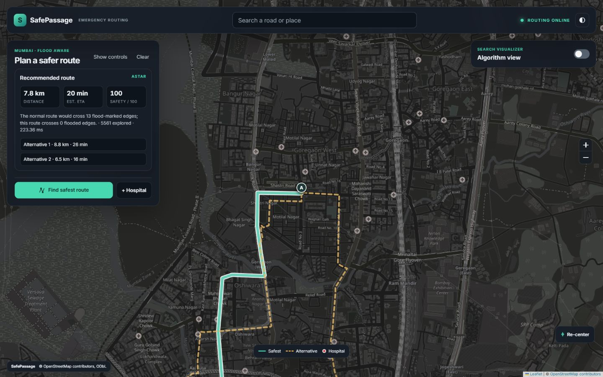
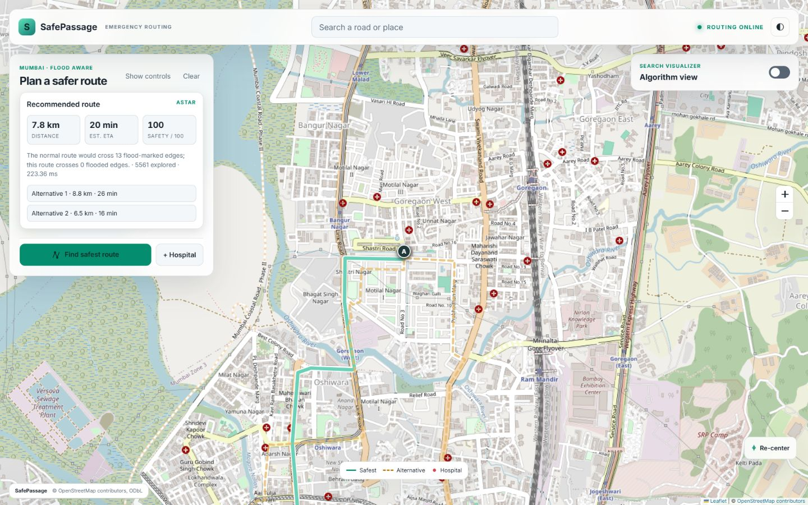
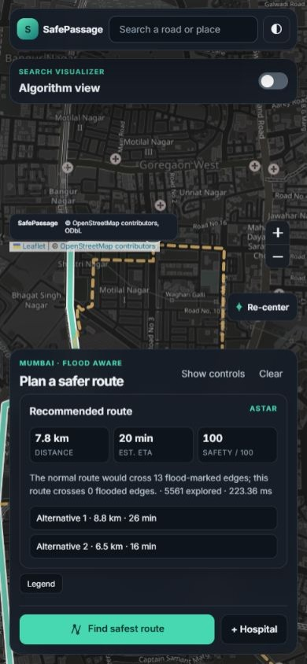
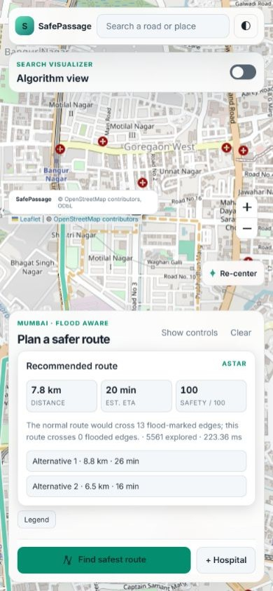
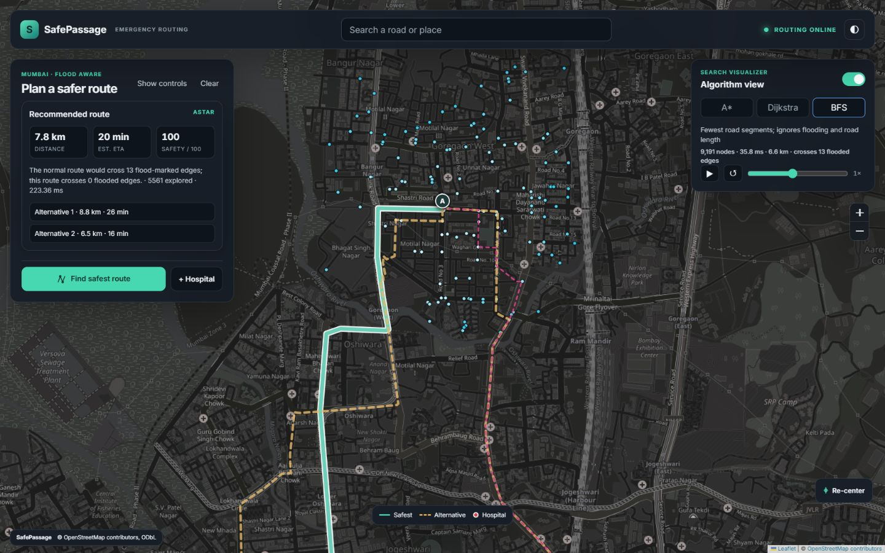
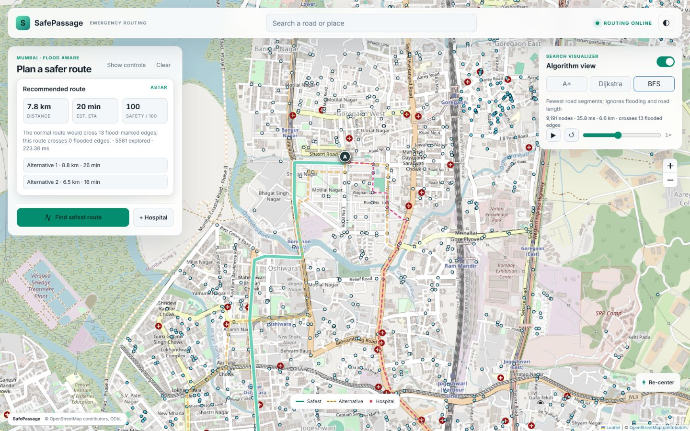
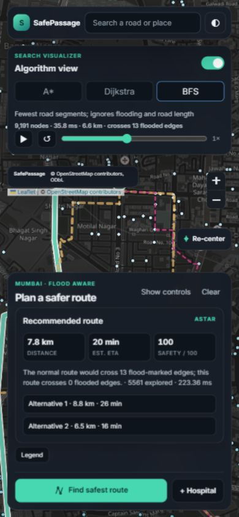
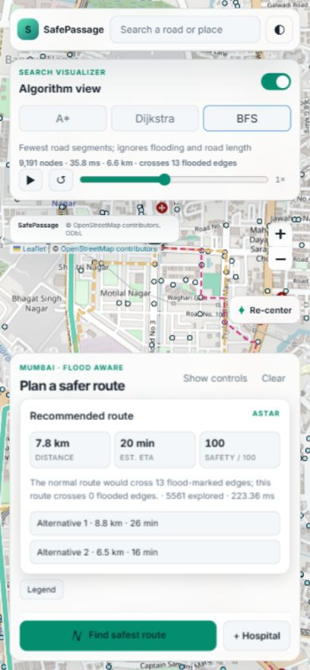
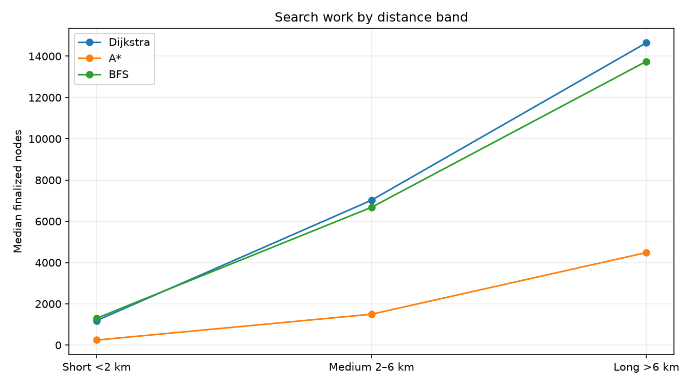
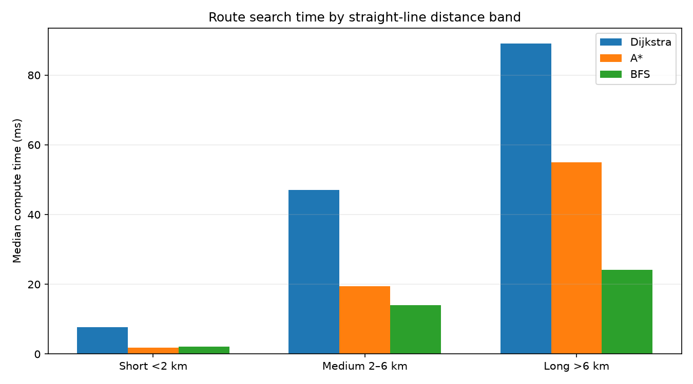

# SafePassage

SafePassage is a flood-aware emergency routing demo for Mumbai, built on a real OpenStreetMap road extract. It explores how route recommendations change when roads are flood-affected or closed. The project implements core data structures and graph algorithms from scratch to make those tradeoffs visible and measurable.

## Highlights

- Routes across a directed graph of **17,787 nodes** and **40,950 edges**.
- A* explores **245.5 nodes vs. Dijkstra’s 1,189 (20.7%)** on short routes, and **1,497.5 vs. 7,021.5 (21.3%)** on medium routes.
- Edge-penalty alternatives take **471.77 ms** median vs. **5,695.86 ms** for exact Yen k=3: about **12.1× faster** in the measured comparison.
- **69 tests pass** (one optional real-graph test is skipped); custom binary MinHeap, union-find, and trie are implemented from scratch.
- A* is not always faster: its long-route p95 is **148.37 ms**, compared with Dijkstra’s **121.07 ms**.

## Screenshots

These demo screenshots show a heavy-rain route with the A* recommendation, flood zones visible, and Algorithm view off. **The demo screenshots will be refreshed as the interface evolves.**

| Desktop · dark | Desktop · light |
| --- | --- |
|  |  |

| Mobile · dark | Mobile · light |
| --- | --- |
|  |  |

### Algorithm view

The separate comparison view visualizes BFS search dots and its final path. These screenshots show BFS selected; the recommendation remains the scenario-aware A* route.

| Desktop · dark | Desktop · light |
| --- | --- |
|  |  |

| Mobile · dark | Mobile · light |
| --- | --- |
|  |  |

## How it works

- A regional OpenStreetMap extract is loaded into a directed road graph with simplified geometry and physical edge lengths.
- Rain and closure scenarios build a scenario graph with adjusted costs or removed roads.
- Safety-aware A* computes the recommended route; its summary and safety score stay independent of the comparison view.
- Dijkstra, A*, and BFS provide separate search traces and final paths for comparison.
- Edge-penalty searches suggest diverse alternatives; multi-source Dijkstra on the reversed graph computes nearest reachable hospitals.
- Union-find identifies disconnected road components and helps report closure cut-offs.

## Features

- Directed road graph with OSM one-way rules, simplified geometry, and physical edge lengths.
- Flood-risk and road-closure scenarios, including combined conditions.
- Route distance, estimated travel time, flooded-edge count, alternatives, and a simulated safety score.
- Nearest reachable hospitals, cut-off analysis, autocomplete, and coordinate snapping.
- FastAPI service and Leaflet UI; no external routing or graph packages at runtime.

## Algorithms and data structures

Let `V` be nodes, `E` directed edges, `K` the requested route count, `P` a queried prefix length, `C` occupied spatial grid cells, and `α(V)` the inverse Ackermann function.

| Component | Used for | Time complexity |
| --- | --- | --- |
| Adjacency-list Graph | Road network and scenario graph copies | Neighbor iteration `O(deg(v))`; whole-graph traversal `O(V+E)` |
| Custom binary MinHeap | Dijkstra, A*, Yen, nearest facilities | Push/pop `O(log V)`; peek `O(1)` |
| Dijkstra | Weighted route search and Yen spur paths | `O((V+E) log V)` with the binary heap |
| A* | Goal-directed weighted route search | Worst case `O((V+E) log V)`; can explore fewer nodes with a useful admissible heuristic |
| BFS | Fewest-edge path and algorithm comparison | `O(V+E)` |
| Yen k-shortest simple paths | Exact loop-free ranked alternatives | Worst case `O(KV(E+V log V))` |
| Edge-penalty alternatives | Faster diverse route suggestions | `O(K(E+V log V))` per fixed number of penalty passes, including graph rebuilds |
| Multi-source Dijkstra on reversed graph | Cost to nearest reachable hospital for every node | `O((V+E) log V)` |
| Union-find | Undirected road components and cut-off reporting | `O((V+E) α(V))` for a graph pass |
| Trie | Case-insensitive road/place prefix search | Insert `O(L)` for name length `L`; prefix walk `O(P)` plus result traversal |
| Uniform spatial grid | Snap a coordinate to the exact nearest graph node | `O(C log C + V)` worst case for cell ordering and distance checks |

## Benchmarks

Measured on the included **17,787-node, 40,950-edge graph** with 200 deterministic pairs in each of three distance bands. The median A*/Dijkstra finalized-node ratios are **0.207** for short routes and **0.213** for medium routes. A* median latency is **1.78 ms** short, **19.39 ms** medium, and **54.99 ms** long. On long routes, A* p95 is **148.37 ms**, slower than Dijkstra’s **121.07 ms**. These are local single-machine measurements, not service guarantees; BFS minimizes hop count rather than weighted travel cost.





Edge-penalty alternatives returned three routes in **471.77 ms** median, compared with **5,695.86 ms** for exact Yen k=3 (about **12.1× faster** in this measured comparison). See [the full benchmark method and tables](docs/BENCHMARKS.md) and [raw results](docs/benchmarks/results.json).

### Service performance

Startup prewarms normal and heavy-rain scenario graphs, the reversed base graph, hospital costs, and A* heuristic coordinates. Measured startup was **4.01 s** with process RSS **124.3 MiB** at readiness. On the same local graph, direct `/api/route` calls with three alternatives took **1.44 s** normal, **1.25 s** heavy rain, and **1.33 s** with one closure on the first request; identical repeats took **56 ms**, **31 ms**, and **220 ms**. The UI loads the main route before alternatives and the normal-route comparison; those follow-up requests took **699 ms**, **931 ms**, and **812 ms**. Details are in the [service profile](docs/BENCHMARKS.md#service-profile-from-this-fix-round).

## Try it

Start the app locally, then call `/api/route` with this verified Mumbai pair:

```bash
curl -X POST http://127.0.0.1:8000/api/route \
  -H "Content-Type: application/json" \
  -d '{"origin":{"lat":19.1597,"lng":72.8399},"destination":{"lat":19.1105,"lng":72.8420},"scenario":"heavy_rain","algorithm":"astar","alternatives":0,"include_normal_comparison":false,"closures":[]}'
```

PowerShell equivalent:

```powershell
$body = @{
  origin = @{ lat = 19.1597; lng = 72.8399 }
  destination = @{ lat = 19.1105; lng = 72.8420 }
  scenario = 'heavy_rain'
  algorithm = 'astar'
  alternatives = 0
  include_normal_comparison = $false
  closures = @()
} | ConvertTo-Json -Depth 5

Invoke-RestMethod -Method Post -Uri http://127.0.0.1:8000/api/route `
  -ContentType 'application/json' -Body $body
```

Trimmed response shape from that pair (the coordinate path is omitted):

```json
{
  "route": {
    "distance_m": 7781.3,
    "duration_s": 1206.6,
    "cost": 9337.6,
    "flooded_edges": 0,
    "safety_score": 100
  },
  "alternatives": [],
  "algorithm": "astar",
  "scenario": "heavy_rain",
  "nodes_explored": 5561,
  "compute_ms": 223.36
}
```

## Run locally on Windows

From the repository root in PowerShell:

```powershell
.\scripts\run.ps1
```

The app is at [http://127.0.0.1:8000](http://127.0.0.1:8000); API docs are at `/docs`. The script runs the venv interpreter and starts Uvicorn from `backend`. Configure environment variables in PowerShell before running if needed; `.env` is read by Docker Compose, not automatically by the local script.

Run the test suite from `backend`:

```powershell
.venv\Scripts\python.exe -m pytest -v
```

Tests use small local fixtures and need neither the network nor `data/raw`. The optional real-graph latency test is explicitly skipped in the suite.

## Docker

Docker and Docker Compose are required. The container image is built in CI; it has not been verified on the author's machine.

In PowerShell from the repository root:

```powershell
Copy-Item .env.example .env
docker compose up --build
```

The app is available at `http://127.0.0.1:8000`. Compose binds the service to loopback; use a reverse proxy for public access. Set tile-provider values in `.env` before deploying. Do not commit `.env` or API keys.

## Project structure

```text
backend/src/safepassage/   Graph, algorithms, structures and FastAPI service
backend/tests/             Offline unit and API tests
frontend/                  Leaflet app, styles and HTML
scripts/                   Data download, demos, comparison and benchmarks
data/processed/            Processed road graph
data/spots/                Filtered OSM hospitals and illustrative flood spots
docs/                      API, benchmark report, charts and screenshots
infrastructure/            AWS deployment guide
Dockerfile                 Runtime image
```

## Data, attribution and limits

Road and hospital data are from **© OpenStreetMap contributors**, licensed under the [ODbL](https://www.openstreetmap.org/copyright). Keep the attribution visible and follow OSM attribution/share-alike requirements. The committed road graph is a small regional extract; hospital tagging in OSM may be incomplete or inconsistent. Flood zones are illustrative, approximate, and not official risk data. Travel times use estimated road-class speeds; they are not live traffic forecasts. The safety score is a scenario metric, not a guarantee of safety or an emergency-service recommendation.

The default OpenStreetMap tile endpoint is for local development. **Do not use the public OSM tile server for a public deployment.** Configure a provider whose free plan covers your expected use (or a paid plan), with a domain-restricted browser key and its required attribution. Check the provider’s current free-plan eligibility, request limits, caching, attribution, and public/commercial deployment terms before launch. Tile keys sent to `/api/meta` are visible to browsers and must be restricted accordingly.

Request guards use in-memory per-process rate counters; they reset on restart and do not coordinate across multiple replicas. When behind a reverse proxy, the direct peer address may be the proxy, so use an appropriate trusted-proxy or edge rate limit for a multi-user public deployment. See [API configuration](docs/API.md) and the [AWS deployment guide](infrastructure/DEPLOY_AWS.md).

## Future work

Use verified flood and hospital datasets, assess routing assumptions with local emergency stakeholders, add live traffic only with a licensed source, and move rate limiting to a shared edge or datastore before scaling beyond one process.

## Author

**Anish Kumar Tiwari** · B.Sc. IT student · Mumbai  
[LinkedIn](https://www.linkedin.com/in/anish-tiwari-8695473a5) · [GitHub](https://github.com/anish84295-eng)

## License

No project license is included. Choose one before accepting contributions or distributing the code.

- **MIT:** concise and permissive, with minimal conditions.
- **Apache-2.0:** permissive with express patent terms; **none:** copyright remains reserved by default.
