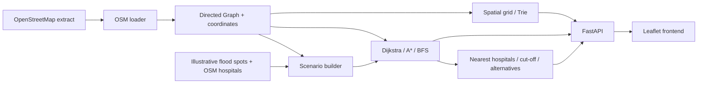

# SafePassage

SafePassage is a flood-aware emergency routing prototype for Mumbai. It turns an OpenStreetMap road extract into a directed weighted graph, compares route searches, and supports illustrative rain-risk and road-closure scenarios, nearest-hospital lookup, cut-off analysis, and road-name search.

## Screenshots

| Desktop · dark | Desktop · light |
| --- | --- |
|  |  |

| Mobile · dark | Mobile · light |
| --- | --- |
|  |  |

All four screenshots above show a calculated route with Algorithm view enabled and BFS selected; the recommendation card remains the safety-aware A* route.

## Features

- Directed road graph with OSM one-way rules, simplified geometry and physical edge lengths.
- Recommended flood-aware A* route plus separate Dijkstra/A*/BFS search traces; animated search visualization never changes the recommended route.
- Rain cost adjustments and configurable road-closure circles, which can be combined.
- Route alternatives, nearest reachable hospitals, unreachable-area analysis, autocomplete, and coordinate snapping.
- Route distance, estimated travel time, flooded-edge count, and a simulated safety score.
- FastAPI service and a Leaflet UI; no external routing or graph packages at runtime.

## Architecture



## Algorithms and data structures

Let `V` be nodes, `E` directed edges, `K` the requested route count, `P` a queried prefix length, `C` occupied spatial grid cells, and `α(V)` the inverse Ackermann function.

| Component | Used for | Time complexity |
| --- | --- | --- |
| Adjacency-list Graph | Road network and scenario graph copies | Neighbor iteration `O(deg(v))`; whole-graph traversal `O(V+E)` |
| Custom binary MinHeap | Dijkstra, A*, Yen, nearest facilities | Push/pop `O(log V)`; peek `O(1)` |
| Dijkstra | Weighted route search and Yen spur paths | `O((V+E) log V)` with the binary heap |
| A* | Goal-directed weighted route search | Worst case `O((V+E) log V)`; can explore fewer nodes with a useful admissible heuristic |
| BFS | Fewest-edge path and algorithm comparison | `O(V+E)` |
| Yen k-shortest simple paths | Exact loop-free ranked alternatives | Worst case `O(KV(E+V log V))` |
| Edge-penalty alternatives | Faster diverse route suggestions | `O(K(E+V log V))` per fixed number of penalty passes, including graph rebuilds |
| Multi-source Dijkstra on reversed graph | Cost to nearest reachable hospital for every node | `O((V+E) log V)` |
| Union-find | Undirected road components and cut-off reporting | `O((V+E) α(V))` for a graph pass |
| Trie | Case-insensitive road/place prefix search | Insert `O(L)` for name length `L`; prefix walk `O(P)` plus result traversal |
| Uniform spatial grid | Snap a coordinate to the exact nearest graph node | `O(C log C + V)` worst case for cell ordering and distance checks |

## Service performance

Startup prewarms normal and heavy-rain scenario graphs, the reversed base graph, hospital costs and A* coordinates. In this round, startup took 4.01 s and process RSS was 124.3 MiB. On the 17,787-node local dataset, direct `/api/route` calls with three alternatives took 1.44 s normal, 1.25 s heavy rain and 1.33 s with one closure on the first request; identical repeats took 56 ms, 31 ms and 220 ms. The browser requests the main path without alternatives or the normal-route comparison first, then fetches both in `/api/alternatives`; that follow-up took 0.70 s normal, 0.93 s heavy rain and 0.81 s with one closure. See [the round profile](docs/BENCHMARKS.md#service-profile-from-this-fix-round).

## Benchmarks

Measured on the included 17,787-node graph with 200 deterministic pairs in each of three distance bands. On this machine, A* median latency was **1.78 ms** for short pairs, **19.39 ms** for medium pairs, and **54.99 ms** for long pairs. Its long-band p95 was **148.37 ms**, slower than Dijkstra’s **121.07 ms**. Edge-penalty alternatives returned three routes in a median **472 ms**, compared with **5,696 ms** for exact Yen k=3. These are local single-machine measurements, not service guarantees; BFS optimizes hop count, not weighted travel cost. See [the full method and tables](docs/BENCHMARKS.md), [raw results](docs/benchmarks/results.json), and [latency chart](docs/benchmarks/algorithm_latency.png).

## Run locally on Windows

From the repository root in PowerShell:

```powershell
.\scripts\run.ps1
```

The app is at [http://127.0.0.1:8000](http://127.0.0.1:8000); API docs are at `/docs`. The script runs the venv interpreter and starts Uvicorn from `backend`. Configure environment variables in PowerShell before running if needed; `.env` is read by Docker Compose, not automatically by the local script.

Run the test suite from `backend`:

```powershell
.venv\Scripts\python.exe -m pytest -v
```

Tests use small local fixtures and need neither the network nor `data/raw`. The optional real-graph latency test is explicitly skipped in the suite.

## Docker

Docker and Docker Compose are required. In PowerShell from the repository root:

```powershell
Copy-Item .env.example .env
docker compose up --build
```

The app is available at `http://127.0.0.1:8000`. Compose binds the service to loopback; use a reverse proxy for public access. Set tile-provider values in `.env` before deploying. Do not commit `.env` or API keys.

## Project structure

```text
backend/src/safepassage/   Graph, algorithms, structures and FastAPI service
backend/tests/             Offline unit and API tests
frontend/                  Leaflet app, styles and HTML
scripts/                   Data download, demos, comparison and benchmarks
data/processed/            Processed road graph
data/spots/                Filtered OSM hospitals and illustrative flood spots
docs/                      API, benchmark report, charts and screenshots
infrastructure/            AWS deployment guide
Dockerfile                 Runtime image
```

## Data, attribution and limits

Road and hospital data are from **© OpenStreetMap contributors**, licensed under the [ODbL](https://www.openstreetmap.org/copyright). Keep the attribution visible and follow OSM attribution/share-alike requirements. The committed road graph is a small regional extract; hospital tagging in OSM may be incomplete or inconsistent. Flood zones are illustrative, approximate, and not official risk data. Travel times use estimated road-class speeds; they are not live traffic forecasts. The safety score is a scenario metric, not a guarantee of safety or an emergency-service recommendation.

The default OpenStreetMap tile endpoint is for local development. **Do not use the public OSM tile server for a public deployment.** Configure a provider whose free plan covers your expected use (or a paid plan), with a domain-restricted browser key and its required attribution. Check the provider’s current free-plan eligibility, request limits, caching, attribution, and public/commercial deployment terms before launch. Tile keys sent to `/api/meta` are visible to browsers and must be restricted accordingly.

Request guards use in-memory per-process rate counters; they reset on restart and do not coordinate across multiple replicas. When behind a reverse proxy, the direct peer address may be the proxy, so use an appropriate trusted-proxy or edge rate limit for a multi-user public deployment. See [API configuration](docs/API.md) and the [AWS deployment guide](infrastructure/DEPLOY_AWS.md).

## Future work

Use verified flood and hospital datasets, assess routing assumptions with local emergency stakeholders, add live traffic only with a licensed source, and move rate limiting to a shared edge or datastore before scaling beyond one process.

## License

No project license is included. Choose one before accepting contributions or distributing the code.

- **MIT:** concise and permissive, with minimal conditions.
- **Apache-2.0:** permissive with express patent terms; **none:** copyright remains reserved by default.
